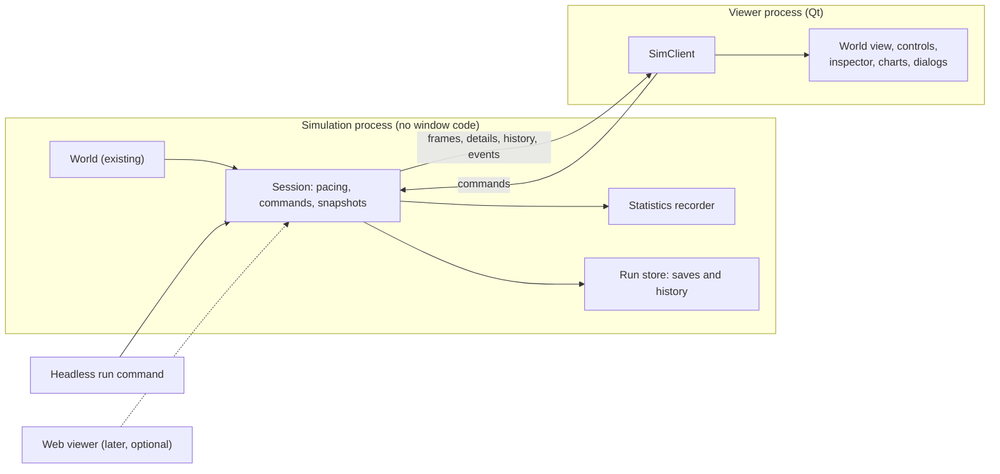

# The graphical interface

Design note for `UX.1`. It answers the owner's question (2026-10-14): "I want a graphical
interface, should we do it web? native Windows?" and plans the builds `UX.6` to `UX.21` in
[TODO.md](../../TODO.md). The owner's questions are
[#123](https://github.com/dwhagar/evolutionSimulator/issues/123) (native or web),
[#124](https://github.com/dwhagar/evolutionSimulator/issues/124) (which computers),
[#125](https://github.com/dwhagar/evolutionSimulator/issues/125) (watch only or change things) and
[#126](https://github.com/dwhagar/evolutionSimulator/issues/126) (save, resume, run without a window);
the ones this note adds are listed at the end. Until they are answered, this note builds on the defaults
written in those issues.

## The short version

- **Build a native desktop program with Qt (PySide6), Windows first.** Charts use pyqtgraph. Nothing
  here needs a web server, and Python is the only language.
- **Keep the simulation and the window apart.** The simulation is the "core" that already exists
  (`World` and the rest, no screen code). The window is a separate layer that draws what the core
  reports. The two talk through a small, fixed set of messages, so the window can be replaced or a
  second one (for example a web page) added later without touching the simulation.
- **Run the simulation in its own process.** One tick of a mid-sized world takes about 44 ms (measured
  below). If the window shared a process with the simulation it would freeze while a tick runs. In
  its own process, the window always answers, however slow or fast the simulation is.
- **Draw from snapshots.** The simulation sends a compact picture of the world (about 54 KB for 300
  animals and 3,000 plants) up to 30 times a second; the window draws the plants once into a
  picture and redraws only the animals each frame. Measured: 1,000 animals and 5,000 plants take
  under 10 ms a frame.
- **Be honest about speed.** Most of the fast time presets cannot be reached with a world this size
  (see [Speed](#speed-and-what-the-window-shows)). The window shows the speed it is really getting.
- **Ship a Windows folder you can unzip and run** (PyInstaller), built by a workflow you start by
  hand, so the weekly-only CI rule stays.

## Native or web

Both work. The question is which one costs less to build well and suits how the simulator will be used:
a long run watched on one computer, with a lot of drawing and a lot of charts.

| | Native desktop (Qt / PySide6) | Local web page (server plus browser) |
| --- | --- | --- |
| Languages | Python only | Python for the simulation, plus HTML, CSS and JavaScript for the page |
| Drawing thousands of creatures | Direct drawing on the CPU (measured below), a GPU path exists if needed | Canvas or WebGL in the browser; as fast or faster, but every frame of data crosses a network connection first |
| Charts and panels | pyqtgraph and ready-made widgets (tables, trees, docks) | Many good libraries (Plotly, uPlot); more of it to assemble |
| Responsiveness at fast speeds | Window and simulation are separate processes; data goes over a local pipe | Same split, plus a server, a socket and a browser tab that may throttle when not in front |
| Watching from another computer or a phone | No (only the machine it runs on) | Yes, this is the real advantage |
| Packaging for Windows | One folder with an `.exe` (a PyInstaller build, about 100 MB) | A Python install and a browser, or the same `.exe` that starts a server and opens a tab |
| Look and polish | Native look, fewer fashion options | Full freedom, easy to restyle |
| Testing | Qt runs without a screen (`QT_QPA_PLATFORM=offscreen`), so windows can be tested | Needs a browser driver (Playwright) for the page, a second test stack |
| Two things to keep in step | One viewer | The page, the server and the simulation |
| Licence | PySide6 is LGPL; pyqtgraph is MIT; the project is CC0 and only depends on them, see below | JavaScript libraries are mostly MIT |

**Recommendation: native (`UX.2` default).** The deciding points: one language, nothing to host, fast
drawing without a network hop, and a Windows `.exe`. The cost is that nobody else can watch over a
network. If that ever matters, the process split makes a web viewer an addition (below), not a rewrite.

**When web would win.** If the owner wants to leave a run on a server and watch from a phone, or to
share a link with others, web is the better first choice. That is the reason the question stays open
in [#123](https://github.com/dwhagar/evolutionSimulator/issues/123).

**Other ways to build a native window, and why not.**

| Option | Verdict |
| --- | --- |
| Tkinter (in the standard library) | Nothing to install, but slow drawing, no good charts, dated look |
| pygame or arcade | Fast drawing, but every button, table and chart would have to be built by hand |
| Dear PyGui | Fast, tool-like, good for dashboards; fewer precedents for packaging, a less familiar look |
| wxPython, Kivy | Workable, smaller communities, weaker chart support than Qt |
| PyQt6 | Same Qt, but GPL: it would pull the whole project's licence. PySide6 is LGPL |
| Streamlit, Dash, NiceGUI (Python web) | Built for forms and reports; their redraw model is a poor fit for a moving world |
| A web page inside a native window (pywebview) | Needs the whole web stack as well, so both costs, little gain |

**Licence note.** The project is released under CC0 and depends on PySide6 (LGPL v3). Depending on it is
fine. A Windows build that ships PySide6's libraries must include its licence text and keep them as
separate, replaceable files, which a PyInstaller *folder* build does and a single-file build does not
as cleanly. `UX.19` carries this.

## Layers and the process split



Three layers, each importable without the one above it:

1. **Core** (`evolution_simulator`, as now): `World`, the traits, the brain. No Qt and no numpy;
   `pyproject.toml` still has `dependencies = []`.
2. **Session** (new, still no Qt): wraps one `World` and runs it at the requested speed, takes commands,
   and produces snapshots. It runs in the simulation process, or directly in the calling process for
   tests and for the headless command.
3. **Viewer** (new, `evolution_simulator.viewer`, needs the `gui` extra: PySide6-Essentials, pyqtgraph,
   numpy): talks to the session only through `SimClient`.

**Why a second process.** Python runs one thread of ordinary code at a time (the "GIL"), so a thread in
the same process would still make the window stutter. A `multiprocessing` process started with
`spawn` (the only mode Windows has) runs on its own core. The cost is that the two cannot share
objects, only messages, and that discipline is also what makes the interface clean.

**How the two talk.** `SimClient` hides the transport. The first version uses a `multiprocessing.Pipe`
carrying small Python objects and `bytes` blocks. A later one can use a local socket or named pipe
(`multiprocessing.connection`) so a headless run can be watched from a window opened afterwards, or a
tiny web server can relay the same messages. The screens never see the difference. The same `SimClient`
interface is also implemented by an in-process version and by a `FakeSimulation` that makes up
a world (random creatures, a scripted population curve). The fake lets every screen be built and
tested before the real host exists, and without waiting for a simulation.

## What the viewer and the simulation exchange

### Commands (viewer to simulation)

One small command set; every future intervention (issue #125) is a new command, not a new channel.

| Command | Meaning | Item |
| --- | --- | --- |
| `new_run(config, seed)` | Build a world from a `WorldConfig` (and the rules tree), populate it, start paused | `UX.17` |
| `play` / `pause` / `step(n)` | Run, stop, or run exactly `n` ticks | `UX.13` |
| `set_speed(preset or seconds-per-second)` | How many simulated seconds per real second | `UX.13` |
| `select(id)` / `deselect` | Send details of this creature (the viewer picks from the snapshot it already has) | `UX.14` |
| `set_snapshot_rate(hz)` / `want(layers)` | The viewer says how often and which parts it needs, so a minimised window costs nothing | `UX.7` |
| `save(name)` / `load(path)` | Write or restore a run | `UX.9`, `UX.18` |
| `shutdown` | Stop cleanly | `UX.7` |
| later: `add_animal`, `remove`, `set_rule`, `edit_genes` | Only if the owner picks "also change things" in [#125](https://github.com/dwhagar/evolutionSimulator/issues/125) | `UX.20` |

### What the simulation publishes

The simulation never waits for the window. It keeps running and offers the newest of each kind.

| Message | Content | Rate |
| --- | --- | --- |
| **Frame** | tick, simulated time and day, daylight, speed asked and speed achieved, and arrays for animals, plants and corpses (below) | up to 30 a second, sooner than that only if something changed |
| **Plants** (part of a frame, sent less often) | position, canopy radius and fullness of every plant | 2 a second, or when the viewer asks |
| **Creature details** | one animal's traits, energy, health, age, sex, pregnancy, last decision, the brain's inputs, hidden values and outputs, the genome, parents | 10 a second while one is selected |
| **History samples** | counts, births, deaths, trait means and spreads, gene histograms (see [Charts](#charts-and-history)) | once per simulated day, sent in batches |
| **Events** | born, died (with the cause), ate, mated, saved, error | as they happen, capped per second |
| **Status** | running, paused, finished loading, crashed (with the error text) | on change |

**The arrays.** A frame is a few packed blocks of `float32` numbers, one block per kind, one row per
creature, so the viewer reads them with `numpy.frombuffer` without a loop. Rows:

| Kind | Fields |
| --- | --- |
| Animal | id, x, y, heading, body radius, energy ratio, health ratio, age ratio (age over lifespan), flags (asleep, pregnant, ready to mate, wandering, sex), diet (meat share of what it can digest), two "family colour" numbers (`family_a`, `family_b`: the genome projected on two fixed directions, so relatives get close numbers; see `lineage.py`) |
| Plant | id, x, y, canopy radius, biomass ratio, flags (ready to seed) |
| Corpse | id, x, y, meat left ratio |

Sizes, measured here on the real world (`World.populate(300, 3000)`, a Python loop writing an `array('f')`):
**54 KB per frame and 1.7 ms to pack**. Scaled to the population caps (1,000 animals, 5,000
plants) that is about 100 KB and at most about 6 ms. At 30 frames a second that is 3 MB a second through a
pipe, which is nothing. The cost to watch is the packing, which happens in the simulation process
between ticks; plants change slowly, which is why they go out less often.

**Frame pacing.** The session loop is: read commands; ask the `Pacer` how many ticks real time owes
(`Pacer` in `world/timescale.py`, already built); run them, but stop early after about 30 ms so commands are
heard; if 33 ms have passed since the last frame, pack and send one. The window acknowledges each
frame; with two frames unacknowledged the simulation drops the frames it would have sent (and says
so in the status). A slow window therefore slows nothing but itself.

**What the core still has to provide.** The existing `World` is enough to read positions, but a viewer
that reaches into `world.animals[i].traits...` would tie the screens to the internals. These pieces are
missing or implicit today, and are the content of the first builds (`UX.6` to `UX.9`):

| Need | Today | What to add |
| --- | --- | --- |
| Read-only views of the world | The viewer would read private-ish attributes | A `snapshot.py` that builds frames, details and statistics from public attributes only, with a version number on the format |
| Events with causes | `StepReport` has only four counts; a death has no cause | An optional listener list (like `add_sleep_listener`): `born`, `died(cause)`, `ate`, `mated`. Off unless something listens, so a headless run pays nothing |
| The brain's last inputs and hidden values | `Brain.decide_with_hidden` exists but the animal does not keep the numbers | Keep them for the selected animal only (the host asks for it), so the inspector can show them live |
| Whole-world save and load | `state_digest()` hashes the world; nothing writes it out | See [Saving](#saving-loading-and-run-history) |
| History | Nothing records the population over time | A statistics recorder driven by the day counter |
| Names for display | Gene ids and brain input and output names exist (`INPUT_NAMES`, `OUTPUT_NAMES`, the layout's gene ids and clusters) | A small catalogue of display names and units, so the inspector does not print `base_fear_weight` |

### As built: the session (`UX.6`)

`evolution_simulator.session` is the contract the screens and the process host build on. It has no
dependencies (a test checks that no core module names Qt or numpy).

- **Core gaps filled.** `World.animal_views()`, `plant_views()`, `corpse_views()` and
  `animal_detail(id)` return immutable values from `world/views.py` (read these, never an organism's
  traits). `World.add_event_listener()` delivers `Born`, `Died` (with a `DeathCause` and the
  killer's id for a bite) and `Mated` events from `world/events.py`; they are built only while
  someone listens, and listening changes nothing about a run. `World.trace_brain(id)` keeps the
  inputs, hidden values and outputs of that animal's last brain run (`AnimalDetail.brain`, filled
  in once its brain has run since).
- **Added for the inspector and the brain view (`UX.29`).** `Ate` joins `Born`, `Died` and `Mated`
  (`world/events.py`): `Ate(tick, eater, food, target, amount)`, one per bite of a plant or a corpse
  that the animal did not refuse (a kill is the victim's `Died` with the killer; the meal from its
  corpse is an `Ate`). `AnimalDetail.network` is a `BrainNetwork` (`brain.py`): hidden biases, the
  weight from each input to each hidden neuron, the weight from each hidden neuron to each output,
  output biases, gain, which genome slots the neurons came from (`slots`, out of `slot_count`) and
  which outputs are signed; a weight inside the dead zone reads 0, so draw a connection where it is
  not 0; learned changes are included. It is read from the brain, not from a run, so it is always
  there and selecting never forces a brain run; only `AnimalDetail.brain` (the live inputs, hidden
  values and outputs) waits for the next run. `AnimalDetail.children` is the ids of the living
  animals that name it as a parent (`World.children_of(id)`, a scan of the animals; a dead child is
  not listed). `evolution_simulator.catalogue` has `describe_gene(id)` and `describe_trait(name)`:
  a display name, a unit and a one-line meaning for every gene of both layouts and every trait of both
  tables; a test fails if a gene or trait is added without one. None of it is state: listening and
  reading a detail leave `state_digest` alone (tested).
- **Session.** `Session(simulation)` takes `handle(command)` (`Play`, `Pause`, `Step(n)`,
  `SetSpeed(preset | seconds per second | "max")`, `Select(id)`, `Deselect`; a bad one raises
  `CommandError`) and `update()`, which runs the ticks real time owes (inside a work budget; the rest
  are dropped and counted) and returns an `Update` with a `Frame` when one is due and the selected
  animal's `AnimalDetail`. `subscribe(callback)` hears the world's events and `StatusChanged`.
  It takes a clock, so tests are exact, and starts paused.
- **Frame.** Three packed `Block`s (animals, corpses, plants): a `uint32` id array, a `float32`
  matrix and a flag byte per row, with the column names in the block, so a viewer reads them with
  `numpy.frombuffer`. About 11 KB for 300 animals; 74 KB when the 3,000 plants ride along, which
  they do only every half second and when the session settles (paused, steps done), so a paused
  world is exact. `FRAME_FORMAT` versions the layout (2 since `UX.30`, which added the animals'
  `family_a` and `family_b` columns). The family colour key is two numbers per animal,
  `lineage.family_key`: the genome's digits projected on two fixed random directions, about 20
  microseconds once per animal (cached) and a pure function of the genome, so it is not saved.
  Relatives get close numbers (a child sits between its parents, a mutant next to the original) and
  unrelated random genomes are about 1 apart on each; a real population is much tighter, so the
  viewer should stretch the range found in the frame (for example between its 5th and 95th
  percentile) over its colour wheel or ramp.
- **FakeSimulation** has the same face as `World` for the session and the screens, with a scripted
  population curve and events; the session tests run every case against both.

### As built: the statistics recorder (`UX.8`)

`evolution_simulator.history` (no dependencies) keeps the history the charts and the run history read.

- **Use.** `Recorder(world)` listens to the world's events and to the end of every step
  (`World.add_step_listener`, new), and once a simulated period has passed (a day, `RecorderRules`)
  takes a `Sample`: levels (animals, plants, corpses, mean energy, health, age, diet and the shares
  asleep, pregnant and ready to mate, mean plant biomass), flows (`births.<kind>`, `deaths.<kind>` and
  `deaths.<kind>.<cause>`; founders put in by hand are not births), a `Stat` (count, mean, standard
  deviation, minimum, maximum) for every trait and single-value gene of the animals and plants
  (`animal.trait.mass`, `animal.gene.size`, from `World.trait_columns`),
  the age at death, and in the first sample and every thirtieth after it a 20-bin histogram per gene.
  A source without `add_step_listener` or `trait_columns` (the `FakeSimulation`) still works: call
  `recorder.observe()` after each step, and the trait statistics are simply absent.
- **Bounded.** Four ring buffers (tiers): 90 days, 52 weeks, 60 months, 128 years, 330 samples at
  most. What falls off the end of a tier is merged into the next, and the last tier merges its two
  oldest samples when full, so nothing is thrown away and memory never grows. Merging is exact for what
  is kept: a merged `Stat` is the statistic of all the individuals together, flows add up, levels are
  averaged by the periods each covers, histograms add. A coarser sample is built from the finer ones, so
  its `span` (periods covered) varies around the nominal length; every sample says its `day` (period it
  ends at) and `span`.
- **What the viewer reads.** `recorder.history()` returns an immutable `HistorySamples`: `tiers`,
  `samples()` (all, oldest first), `series(name)` (days and values, flows per period so tiers share one
  scale), `stat_series(name)`, `histogram_at(name, day)` for scrubbing, `names()` and `stat_names()`.
- **Does not touch the run.** It only reads; the world builds events and calls step listeners only
  while someone listens, and a test checks that a run has the same `state_digest` with and without a
  recorder.
- **Saved.** `HistorySamples.to_dict()` / `from_dict()` and `recorder.to_dict()` / `Recorder.restore(world, data)`
  (the latter also keeps the counters since the last sample, so a restored world and recorder carry on
  exactly as an uninterrupted pair; tested with `save_world`). `save_history(path)` writes JSON, gzip by
  suffix. The run store (`UX.10`, below) puts this file beside the world checkpoints.

### As built: the run store (`UX.10`)

`evolution_simulator.runs` (no dependencies, no window code):

```
<runs folder>/<run id>/            id = <UTC date-time>-<name slug>
    run.json                       manifest: format, name, seed, program version, created/updated,
                                   config (readable), summary for the run list
    history.json.gz                the recorded history as of the latest checkpoint (for charts)
    checkpoints/checkpoint-<tick>/ meta.json, world.json.gz, history.json.gz (the recorder's state)
```

- **The folder.** `RunStore(root, rules, clock)`; `default_runs_root()` gives the per-user default
  (`%LOCALAPPDATA%\evolutionSimulator\runs` on Windows, `~/Library/Application Support/...` on macOS,
  `$XDG_DATA_HOME` or `~/.local/share/...` elsewhere). Everything takes the folder as an argument, so
  tests and the headless command use any other, and the clock is injectable.
- **Index and listing.** `run.json` is the history index: `store.list_runs()` reads only manifests and
  returns `RunSummary` rows (newest first) with seed, versions, simulated age, last animals and plants,
  checkpoint count and a 60-point population series for a small chart. Unreadable folders are skipped.
- **Checkpoints.** `run.checkpoint(world, recorder)` writes a hidden folder and renames it into place, so a
  crash leaves the previous checkpoint whole. Each checkpoint holds the world and the recorder's state
  taken together, so resuming from any of them is consistent. `store.create(world, recorder=...)` writes
  the first one at once.
- **Autosave.** `run.autosave(world, recorder)` listens to every step and checkpoints once
  `checkpoint_every_days` simulated days (default 10) **and** `min_wall_seconds` real seconds (default
  60) have passed. `saver.finish()` writes a last one. Retention (`RunStoreRules`): the newest
  `keep_newest` (3) plus the first checkpoint of every simulated year (`year_days`, 365.25), so the start
  always stays. These numbers are rules fields.
- **Resume.** `run.resume()` returns `Resumed(world, recorder, checkpoint)` from the newest checkpoint that
  reads (older ones if it is damaged), or a named one. A test runs a world straight through and, in
  parallel, the same world checkpointed, resumed and continued, and requires the same `state_digest` and
  the same history.
- **Space (`UX.25`).** Runs are never deleted unless asked (`store.delete(id)`); `store.space_warning()` returns
  a sentence once the folder holds more than `warn_bytes` (5 GB).

### As built: the shell (`UX.11`)

`evolution_simulator.viewer` is the PySide6 window, behind the `gui` extra (`pip install
"evolution-simulator[gui]"`: PySide6, numpy, pyqtgraph). The core never imports it (the isolation test
skips this package and still checks that `viewer.backend` and `viewer.app` load without Qt).
`evolution-simulator-gui` or `python -m evolution_simulator.viewer` opens it, on `FakeSimulation` by
default and the real world with `--world` (in this process, until UX.7 and UX.17 exist).

- **Backend.** The window talks to a `Backend` (`send(command)`, `poll() -> Batch`, `status`) and never
  to a `Session`. `LocalBackend` runs a `Session` in the same process; UX.7's client fits the same two
  methods.
- **Controller.** `ViewerController` polls the backend every 16 ms and emits `frame_received`,
  `detail_received`, `status_changed`, `event_received`, `command_failed` and `backend_failed`. It keeps
  the latest `frame`, `detail`, `status` and `plants` (a frame that carries no plants leaves the last
  ones in `controller.plants`). A panel only connects to signals; it starts from the latest values when
  it is built late.
- **Panels.** Each module in `viewer/panels/` whose name does not start with `_` exposes `PANEL`, a
  `PanelSpec` (id, title, area `center|left|right|top|bottom`, a `factory(context)` and an order), or a
  tuple of them. The window finds them by itself, so a screen is its own file and nothing shared is
  edited. The shell ships placeholders in `world.py` (centre), `controls.py` (top), `inspector.py` and
  `charts.py` (right, stacked): UX.12 to UX.16 replace the module with the same name and keep its
  `PANEL.id` and `area`; UX.17 adds a module. A module that fails to import, or a factory that raises,
  is logged and replaced by a message in its slot instead of stopping the window.
- **Context.** `factory(context)` gets a `ViewerContext`: `context.controller`, `context.send(command)`,
  `context.show_message(text)` for the status bar, and `context.actions`, the window's actions by name
  (`play_pause`, `step`, `speed_<preset>`, `speed_max`, `quit`, `reset_layout`, `about`). A button
  should share an action rather than make a second one, so the shortcuts (Space, Right) and the checked
  speed stay in one place; UX.13 owns the rest of the keys.
- **Window.** Menus File, Run, View (a toggle for each dock, and Reset layout) and Help; a status bar with
  the run label, the clock, day or night, tick, counts and speed asked and got. Geometry and dock state
  are saved on close with `QSettings` and restored on start (`--settings FILE` keeps them in an `.ini`
  instead); `LAYOUT_VERSION` in `viewer/window.py` is bumped when the default docks change so an old
  saved layout is dropped.
- **Tests.** `tests/conftest.py` has a `qapp` fixture on Qt's offscreen platform; tests that use it
  skip when PySide6 (or a library it needs on Linux, such as `libEGL`) is missing. A new screen's test
  builds the panel with `MainWindow(controller, specs=[...])` over a `LocalBackend(Session(FakeSimulation(...),
  clock=...))` and calls `controller.poll()` to deliver frames without a timer.

### As built: the headless run (`UX.22`)

`python -m evolution_simulator run --until 100y --out runs/` runs a world with no window through the run
store (`runs/headless.py`, command line in `__main__.py`; core only, no Qt):

```
python -m evolution_simulator run --until 100y [--config c.json] [--seed N] [--animals N] [--plants N]
                                  [--name NAME] [--out DIR] [--checkpoint-days D] [--keep-newest N]
                                  [--min-wall-seconds S] [--keep-going] [--quiet]
python -m evolution_simulator run --resume <run id | latest> --until 200y --out runs/
python -m evolution_simulator list --out runs/
```

- **`--until`** is the simulated time to reach from the start of the world: `30s`, `10min`, `12h`, `30d`,
  `2w`, `6mo`, `100y` (365.25 days) or `5000t` (ticks of this world). On `--resume` it is still counted
  from the start, so the same `--until` finishes an interrupted run.
- **`--config`** is JSON in the form `persistence.config_to_dict` writes (missing fields take their
  defaults, unknown ones are refused); a run's own `run.json` works too, which repeats a run's settings.
  `--seed` overrides the file's seed. Without a file the default config is used.
- **What it writes.** A new run folder (`UX.10`) with the recorder's history and autosaved checkpoints;
  a last checkpoint is always written, also on Ctrl-C (exit code 130) or when every animal has died (the
  run stops there unless `--keep-going`). Progress lines show the simulated age, populations and ticks per
  second; the last line names the folder and the `--resume` to use. Errors print `error: ...` and exit 2.
- **Resuming** restores the newest checkpoint that reads, with its recorder, and goes on exactly as an
  uninterrupted run (tested with `state_digest` and the history). The viewer opens the same folder from
  Run history.

### As built: the process host and `SimClient` (`UX.7`)

- **`Host`** (`session/host.py`) is a `Session` plus the rules of talking to a viewer, with no transport:
  `receive(message)` and `step()` (returns the messages to send). It runs inside the simulation process
  (`run_host`, the target of the spawned process) and inside the viewer's own process
  (`InProcessClient`), so both behave the same and the logic is tested without a process.
- **Back-pressure.** Frames, details and event batches count as in flight until the viewer sends
  `Ack(received)`; with `HostRules.max_in_flight` (4) unacknowledged, no frame is built
  (`Session.update(frames=False)`) and event batches wait. A dead animal's last detail is always sent.
  `HostInfo` (about once a second) reports frames sent and dropped. Events are capped at
  `max_events_per_second` and buffered at most `max_buffered_events`; what is left out is counted in
  `EventBatch.dropped`.
- **Messages** (`session/messages.py`, plain frozen values): viewer to simulation `Command`s plus
  `Ack`, `SetFrameRate(hz)` (0 stops frames), `RequestPlants`, `Shutdown`; simulation to viewer
  `Ready(frame)`, `Frame`, `AnimalDetail`, `EventBatch`, `CommandRejected`, `HostInfo`, `Crashed(report)`,
  `Stopped`. A refused command comes back as `CommandRejected`, never as an exception in the viewer.
- **`SimClient`** has `send(request)`, `poll() -> Inbox`, `close()` and `crashed`. `poll` is the
  acknowledgement and never blocks; frames that piled up are folded into the newest, keeping the plants
  of the last frame that had them. `ProcessClient(recipe)` spawns the process (`multiprocessing`
  `spawn`; a frozen `.exe` must call `multiprocessing.freeze_support()` first in `__main__`),
  `InProcessClient(simulation_or_recipe)` runs the host from `poll`, and `fake_client(animals=...)` is an
  `InProcessClient` on a `FakeSimulation`.
- **Recipes.** A spawned process is handed a picklable callable that builds the simulation there:
  `WorldSpec(config, animals, plants)` and `FakeSpec(...)`.
- **Failures.** An exception while building or running becomes `Crashed(traceback)` and exit code 1; a
  process killed from outside is noticed when the pipe ends ("ended without a word", with the exit code).

### As built: time and speed controls (`UX.13`)

`viewer/panels/controls.py` replaces the placeholder in the top dock (same `PANEL` id and area).

- **Buttons.** Play or pause and Step are the window's own actions (`play_pause`, `step`), so the menu,
  the buttons and the keys are one thing. "Step a day" sends `Step(n)` with `n` the ticks in a simulated
  day, worked out from the tick length the frames imply (24 at the hourly default). One button per speed
  preset and one for as fast as possible; they trigger the window's `speed_<preset>` actions and show
  the checked one, none when the speed is a custom one. A custom speed is a number and a unit (seconds
  to years) with "Set speed". Following [#130](https://github.com/dwhagar/evolutionSimulator/issues/130)'s
  stated default, every preset is kept (none hidden), the view glides between ticks (UX.12) and the
  speed is shown asked against got.
- **Readout.** Run state (running, paused, or stepping with the ticks left), elapsed simulated time, the
  day number and day or night with the daylight percentage, the speed asked and the speed got (`-`
  while paused; "(behind)" when the computer cannot keep up).
- **Keys** (`KEY_MAP`, the one table of the viewer's keys): Space play or pause, Right step one tick,
  Shift+Right step a day, `+` (or `=`) faster, `-` slower, `M` as fast as possible. The new actions are
  put on the main window and in the Run menu (the Speed submenu for the speed ones), so the keys work
  with the Controls dock closed or floating. `F` (follow, UX.12) and `Esc` (deselect, UX.14) are left to
  those panels; a panel that adds a key adds it to `KEY_MAP`'s table in its own change.
- **"Don't draw when fast".** A checkable action `no_draw_fast_forward` in `context.actions` (also in the
  Speed submenu). The world view calls `controls.world_drawing_paused(context.actions, status)` and
  skips painting when it is true: the switch is on, the run is going, and the speed asked is a decade a
  second or more (or as fast as possible). The panel shows a note while that is so. It saves only the
  drawing; freeing the session from packing frames needs UX.7's `want` command.
- **Tests.** `tests/test_viewer_controls.py`: the pure helpers (`neighbour_speed`, `ticks_per_day`, the
  text), the buttons against the window's actions, the readouts against frames, the custom speed, the
  no-draw logic, and the keys through `QTest.keyClick`.

### As built: saved runs in the viewer (`UX.18`)

`viewer/run_manager.py` (`RunManager`, one per controller) joins the run store to the window, and the screens
are `viewer/panels/runs.py` plus `viewer/panels/_run_history.py`:

- **Save run now** (File, Ctrl+S). The first save starts a run (named after its seed unless given a name) with
  a `Recorder` and an autosave (`UX.10`'s rules), so the run keeps checkpointing as it goes; later saves add a
  checkpoint to the same run. A world that ran before the first save has history only from that point.
  `manager.detach()` lets the current run go (with a last checkpoint) for a new world; `UX.17` calls it.
- **Saved runs** (File, Ctrl+O, or View): a dock, hidden at first, with one row per run: name, seed, program
  version, simulated time, last saved, animals, plants, size and a small population line. Buttons: Save run
  now, Resume, History (also a double-click), Export history (CSV), Delete, Refresh. The run on screen is in
  bold. The size warning of `UX.25` (5 GB by default) shows above the list and again after a save.
- **Resume** restores the newest checkpoint that reads (or the one picked in the history window), builds a new
  `Session` on it, and swaps it in behind the controller with `ViewerController.replace_backend`, which clears
  the cached frame, detail and plants and emits `backend_replaced`. The world shows paused. A different run on
  screen gets a last checkpoint first; resuming the run on screen goes back to its saved state, and both that
  and a world that was never saved ask before anything is lost.
- **History** is a window of its own per run (several can be open), read only: the facts, the charts, and the
  checkpoint list with Resume from the selected one. The charts are the charts panel itself over one finished
  history (`panels/charts.history_view(samples)`, a `ChartsPanel` with no controller); if that is missing or
  fails, a plain animals and plants chart stands in. A run with no history samples yet says so.
- **Shell hooks** added for this: `ViewerContext.add_menu_action(menu, action)` (File actions sit above Quit),
  `ViewerContext.set_run_label(text)` (status bar and title), `MainWindow.add_menu_action` and
  `set_run_label`, `ViewerController.replace_backend` and `backend_replaced`, and `--runs-folder DIR` on the
  command line. A screen that holds anything about the old run (a selected animal, a trail) should drop it on
  `backend_replaced` (the charts panel does). `LocalBackend(session, record=recorder)` takes a recorder that is
  already listening, which is how a resumed run keeps its history; `RunManager` saves with the backend's own
  recorder, so there is one per world.
- **Limits.** Saving and resuming work on a `LocalBackend` (the world is in the window's process), through
  `RunManager.local_world()`. Through the process host they wait for `UX.31` (the host creating the recorder,
  sending history and starting from `Run.resume`); that function is the one place to change. Listing, history,
  export and delete need no world and work with any backend.
### As built: the charts (`UX.16`)

`viewer/panels/charts.py` replaces the placeholder (same `PANEL` id `charts`, area `right`) with five
pyqtgraph tabs over `HistorySamples`, and nothing in it reads the world.

- **History reaches the screen through the backend.** `Batch.history` carries the recorder's
  `HistorySamples` in the batch that follows each new sample (once per simulated day, not every
  frame), `ViewerController` keeps it as `controller.history` and emits `history_received`, and a
  panel built late starts from the latest. `LocalBackend` makes the `Recorder` itself (`record=False`
  for none) and calls `observe()` on each poll, so the `FakeSimulation`, which has no step listener,
  is sampled once per poll (a long update gives one coarser sample). **UX.7's client has to carry
  the history in its batches** the same way (a `HistorySamples` or its `to_dict`, once per sample),
  and **UX.10** will load a saved history into the same signal.
- **Tabs.** Population (animals, plants, corpses); Births and deaths (animals or plants, with the
  deaths split by cause, only the causes that happened); Condition (average energy, health, age and
  diet, and the shares asleep, pregnant and ready to mate); Traits and genes (any recorded statistic
  of the animals or the plants: its mean, a band of one standard deviation kept inside the range
  seen, and the lowest and highest, which can be hidden); Gene distribution (the 20-bin histogram of
  a gene as shares of the population, with a slider over the days that have one, which follows the
  newest unless the user scrubbed back).
- **Axis.** Simulated days, and years once the newest sample is two years in; flows are per day on
  every tier. Mouse wheel zooms and drag pans, right-click is pyqtgraph's menu (it also exports an
  image), and "Reset view" fits the data again.
- **Differences from the first sketch.** The band is the mean plus or minus one deviation, not the
  10th to 90th percentile, because the recorder keeps the mean, deviation, lowest and highest and not
  percentiles. The number of lineages is not charted (the recorder does not count them; a separate
  item if wanted). Stat names are made readable by `pretty_stat`; the display-name catalogue
  (UX.29) can replace it.
- **Drawing.** Redraws are throttled (200 ms) and only the tab in view is drawn, and only while the
  panel is visible, so a fast-forward costs the charts almost nothing. Colours are the Okabe and Ito
  colour-blind-safe set, one fixed colour per death cause, and the plots take the window's own
  background and text colours.
- **Tests.** `tests/test_charts.py`: the helpers, the history path (backend, controller), and every
  tab against a real ten-day world history and made-up ones, offscreen.

### As built: history and the run through the host (`UX.31`)

- **Messages added** (`session/messages.py`; `Frame`, `Status` and the commands are unchanged). Viewer to
  host: `RequestHistory` (send the whole history again) and `SaveNow` (checkpoint the run now; refused
  when there is no run). Host to viewer: `HistoryBatch(rules, samples, full)` and
  `RunNotice(run_id, name, path, checkpoints, last_checkpoint, saved, resumed_from)`. Both count as in
  flight and are acknowledged like frames, so a slow window holds them back and loses nothing.
- **History.** `Host` keeps a `Recorder` (UX.8) for its world: one the recipe made, or its own unless
  `HostRules.record` is false. The first step after `Ready` sends `HistoryBatch(full=...)`, the whole
  `HistorySamples` (empty for a new run, the recorded past for a resumed one). After that every new
  single-day sample goes out in a batch at most every `history_interval` (0.25 s), a few at a time at high
  speed. A viewer that has fallen more than `max_pending_samples` (400) behind is sent the whole history
  instead (the same message with `full`), as is one that sends `RequestHistory`. A `Sample` is about 2 KB
  and a full history up to about 800 KB (230 KB after 95 days), so the whole history is the rare case.
- **The viewer's copy.** `history.HistoryMirror` merges the new samples into the same ring buffers the
  recorder uses (`history.push_sample`), so after any number of samples its `history()` equals the
  recorder's. The clients do this: `Inbox.history` is that `HistorySamples`, set in the poll that brought
  news and `None` otherwise, which is exactly what `Batch.history` carries in `viewer.backend`; an
  adapter from `Inbox` to `Batch` copies it across. `Inbox.run` is the newest `RunNotice`.
  `Recorder.add_sample_listener` is the hook that lets the host see each sample.
- **A run.** A recipe may return `Prepared(simulation, recorder, run, resumed_from)` instead of a bare
  simulation. `NewRunSpec(root, config, animals, plants, name)` creates a world and a run folder in the run
  store (UX.10) with its first checkpoint; `ResumeSpec(root, run_id="latest", checkpoint=None)` restores a
  run's newest readable checkpoint with its recorder. With a run the host autosaves (the store's own rules:
  every few simulated days and no oftener than a minimum of real time), checkpoints on `SaveNow`, and
  writes one last checkpoint when it shuts down (a `Shutdown` message, or closing an `InProcessClient`),
  and sends a `RunNotice` at the start and after each checkpoint. A `ProcessClient` that is closed waits
  `join_timeout` (5 s) for that last checkpoint before it ends the process; a checkpoint is written to a
  scratch folder and moved into place, so one cut off then leaves the previous one intact.
- **Tests.** `tests/test_host_history.py` (the batches, back-pressure, the overflow, a hand-made
  recorder, a run saved and resumed in process and over a real pipe) and
  `tests/test_history_mirror.py` (the mirror equals the recorder through every tier, including the last
  one's merging).

### As built: the Windows package (`UX.19`)

- **Files.** `packaging/entry.py` is the program PyInstaller freezes; `packaging/evolutionSimulator.spec`
  is the one-folder, windowed spec; `scripts/package.py` builds it, adds `LICENSE`,
  `THIRD_PARTY_NOTICES.md`, a short `README.txt` and `VERSION`, and zips to
  `dist/evolutionSimulator-<version>-win64.zip` (`linux64` on Linux). `pip install -e ".[gui,package]"`
  gives it everything. The `gui` extra now names `PySide6-Essentials`.
- **Second process.** `entry.py` calls `multiprocessing.freeze_support()` first, and
  `viewer/__main__.py` is guarded too (a spawned process imports its main module and must not open a
  second window). `evolutionSimulator.exe --selftest` starts a `ProcessClient` on a `FakeSpec`,
  steps five ticks and exits 0 when a frame came back: it opens no window, so the workflow runs it on a
  runner with no screen. The viewer does not use `ProcessClient` yet; the selftest keeps the frozen
  second-process start covered until it does.
- **No console.** A windowed program has `sys.stdout` and `sys.stderr` set to `None`; `entry.py` points
  them at the null device so a stray `print` cannot raise. `copy_metadata` carries the package
  metadata so `__version__` works. There are no data files in `src` yet; when a screen adds one (a
  palette, an icon), list it in the spec's `datas`.
- **Workflow.** `.github/workflows/package-windows.yml` runs on `workflow_dispatch` only (CI stays
  weekly), builds on `windows-latest`, runs `--selftest` and a `--quit-after` launch under Qt's
  offscreen platform, and uploads the zip as a workflow artifact.
- **Notices.** PySide6 and Qt are LGPL v3 and ship as separate DLLs, which the notice says can be replaced.
  `README.md` explains the unsigned zip and the SmartScreen warning (owner question
  [#132](https://github.com/dwhagar/evolutionSimulator/issues/132): default accepted).
- **Tested on Linux** (`tests/test_packaging.py`): the spec runs against PyInstaller stand-ins, the
  entry point under `freeze_support`, the package script's helpers and the zip layout; a real Linux
  PyInstaller build and run of the frozen program was done by hand. **Not tested without Windows:** see
  the checklist in the UX.19 pull request (a real build, the SmartScreen flow, and the pipe-block finding:
  a hung viewer holding four unacknowledged frames must not stall the host's `Pipe.send`).

### As built: the setup screen (`UX.17`)

File > New run (Ctrl+N) opens the **New run** dock (`viewer/panels/setup.py`, left, closed at first).
From the top: a preset box (Default, Small and quick, Large world, No night, No learning, and the
user's own), the counts, the seed with a Random button, the seeded-brain switch, a filter box, the
settings form, a line that says what is wrong (Start is disabled until nothing is), and Start run.

- **The form is generated.** `viewer/config_form.py` builds a `ConfigForm` from any frozen dataclass
  instance: a check box for a `bool`, a text box for numbers, text and tuples, a collapsible section for
  a nested dataclass, and a section with an *on* box for `X | None` (day cycle, learning). Nothing names
  a field, so when TRAIT.11 moved the bite, corpse and world settings into `TraitRules` the form picked them
  up with no change (any later field will too). The tooltip is the one-line text under the field in the source (read by `viewer/configdata.py`
  from the class source, so a frozen build without source shows only the default), a bold label means the
  value differs from the default and a section header counts its changes. `value()` builds the dataclass
  with the classes' own checks and raises `ConfigError` with the dotted path of the bad field. The seed
  is left out of the form (`skip`) and has its own box.
- **The command.** `NewRun(config, animals, plants, seeded)` is a new `Command` (`session/commands.py`);
  `Session.handle` builds the world with `build_world` (or the `new_run=` factory a test passes), swaps it
  in and publishes `RunStarted(label, animals, plants)`. The new run is paused at tick 0, nothing is
  selected, and the next frame carries the plants. The speed the viewer had set stays unless the config's
  own `traits.time.speed` was changed from its default. A world that cannot be built raises
  `CommandError` and changes nothing. The frame counter (`seq`) goes on rising. The counts are checked
  against the config's `max_animals` and `max_plants`. `ViewerController` drops its frame, plants and
  detail on `RunStarted` (and forwards the event), and the window renames itself from it.
- **Presets** are `RunSetup` values (`viewer/presets.py`: counts, seeded, `WorldConfig`) saved as JSON
  (`configdata.to_data` and `from_data`; a missing field keeps its default and an unknown one is ignored,
  so old presets survive a changed config). The user's presets and the last run started live in the
  viewer settings under `setup/presets` and `setup/last`; a panel reaches the settings through
  `ViewerContext.settings`.
- **Where the world is built.** The command carries the config and `Session` builds the world, so with
  the process host (UX.7) a large world is built in the simulation process and the window stays alive;
  `LocalBackend` builds it in the viewer's process, which freezes the window for a moment. The host never
  drops `RunStarted` (it is exempt from the event caps) and discards the old run's pending world events.
  `LocalBackend` starts a new `Recorder` on the new world and publishes the empty history at once, so
  the charts clear; `ViewerController` also forgets `history`.
- **Saved runs (UX.18).** The File entry and the label come through `ViewerContext.add_menu_action`
  and `set_run_label`. Starting a run asks `RunManager`: if a saved run is current, `detach()` writes its
  last checkpoint before the world is replaced and nothing is asked; a world that was never saved
  (tick above 0, no current run) is only replaced after a yes. The new run is not saved until Save run
  now.
- **Found on the way.** `LocalBackend` subscribed `self._events.append` and then rebound `self._events`
  in each poll, so every event after the first poll went into a list nobody read. It subscribes a method
  now (`_heard`) and a test polls twice.

## Speed and what the window shows

At the hourly default tick a tick is one simulated hour (`WORLD.7`), so the speed presets need these
ticks per real second: hour 1, day 24, week 168, month 730, year 8,766 and more above that. Measured
on this sandbox's CPU (one core, pure Python): **44 ms per tick at 300 animals and 3,000 plants**,
about 23 ticks a second, and about 5 ms per tick at 60 animals and 300 plants, about 200 a second.
So with a mid-sized world the presets up to "day" are met, "week" and above are not, and with a very small
world "week" is met. My estimate for the caps (1,000 animals, 5,000 plants) is 100 to 200 ms a tick,
about 5 to 10 ticks a second, which is just short of "day". The real figures depend on the computer.

What this means for the window:

- **Show the achieved speed next to the requested one**, for example "week/s asked, 3.1 days/s got". The
  `TimeScale` and `Pacer` code already drops the excess instead of queueing it.
- **Offer "as fast as the computer can" as a preset** next to the fixed ones.
- **Below about 3 frames a second of ticks, nothing visibly moves between ticks,** and with an hourly
  tick that is every preset below "hour": the picture is still for a minute at a time. Fix: **draw
  one tick behind and slide each creature from where it was to where it is** over the real time the
  tick takes. At "hour" that is a creature gliding over a second; at "real-time" it is a glide over an
  hour, which looks still, as it should. When paused, show the exact current state. Above about 10
  ticks a second this is not needed. (Question 2 under [Questions this note adds](#questions-this-note-adds), [#130](https://github.com/dwhagar/evolutionSimulator/issues/130): hide the presets below "hour"?)
- **Past what the eye can follow** (a decade a second and up, which the simulation cannot reach
  anyway), frames are only a blur. The view lowers its own frame rate and the charts become the thing to
  watch. A "hide the world while fast-forwarding" switch frees the simulation from packing frames.
- **Make quitting and pausing instant.** `pause` is only checked between ticks, so the longest wait is
  one tick (up to a few tenths of a second at the caps). The session says "pausing…" until it stops.

## The screens

One main window with dockable panels (they can be dragged, closed and put back), a menu bar and a
status bar. A sketch of the default layout:

```
+--------------------------------------------------------------------------------------+
| File  Run  View  Help                                                                |
+--------------------------------------------------------------------------------------+
| [Play] [Pause] [Step]   Speed: [1h][1d][1w][1mo][1y][10y][max]   asked 1w  got 3.1d  |
+--------------------------------------+-----------------------------------------------+
|                                      |  Creature #412        [Body|Genes|Brain|Family]|
|                                      |  Female, 3 months old (12% of a life)         |
|        WORLD VIEW                    |  Energy  ######----  61%    Health ######### |
|     (pan: drag, zoom: wheel,         |  Asleep: no   Pregnant: yes (litter of 2)     |
|      click a creature to select)     |  Doing:   turning left, eating                |
|                                      |  ...                                          |
|                                      +-----------------------------------------------+
|                                      |  Charts   [Population|Genes|Births/Deaths]    |
|                                      |   /\    /\                                    |
|                                      |  /  \__/  \__                                 |
+--------------------------------------+-----------------------------------------------+
| Day 41, night  |  Tick 1,000  |  Animals 118  Plants 2,310  |  Seed 7  |  saved 2 min |
+--------------------------------------------------------------------------------------+
```

### World view (`UX.12`)

Top-down view of the box. Drag to pan, wheel to zoom, double-click to fit. The edge is a visible wall.
Day and night tint the ground, matching `World.daylight`. A scale bar in world units (the simulation
has no metres). Layers that can be switched: plants, corpses, animals, a grid, the selected creature's
senses (a wedge for vision using its field of view, circles for hearing and smell, a ring for touch),
and its trail. **Colour by:** diet (default: meat eaters warm, plant eaters cool), sex, energy,
age, or family colour (so species and lineages show up as groups). Animals are small triangles
pointing along their heading; sleeping ones are dimmed and drawn with a mark; pregnant ones have a
dot. A small overview map appears when zoomed in. Colours come from a colour-blind-safe palette, and
no meaning rests on colour alone (shape or marks also differ).

### Controls and status (`UX.13`)

Play, pause, single step and "step a day"; the speed presets from `TimeScale`, a custom value, and
"as fast as possible"; the requested versus achieved speed; the simulated clock ("year 2, day 41, 03:00"),
day or night, the tick, the counts, the seed, and the run name. Keyboard: space to play or pause, the
arrow keys to step, `+`/`-` for speed, `F` to follow the selected creature. (As built: the keys are
listed under "As built: time and speed controls (`UX.13`)".)

### Creature inspector (`UX.14`, brain tab `UX.15`)

Click a creature (or pick it from a list) and a panel shows tabs:

- **Body:** age and life stage, sex, energy, health, size, the sleep and pregnancy state, the current
  decision in words ("turning left, fast, eating"), the senses' ranges and the traits with their
  units.
- **Genes:** the genome as the named genes grouped by their clusters (see
  [gene-clusters.md](gene-clusters.md)), each as a bar from low to high, next to the population's average so
  that unusual genes stand out. A toggle shows the raw digits.
- **Brain:** the network drawn as three columns (the 20 named inputs, the hidden neurons, the six
  outputs) with the live value on each and the weights as line thickness and colour; a second view
  lists only the inputs and outputs as bars. Dormant neurons are greyed
  ([brain-shape.md](brain-shape.md)). It shows what the creature "sees" and decides, tick by tick.
- **Family:** parents, children, the closest relatives alive, and a "select" link on each.

### Charts and history (`UX.16`)

pyqtgraph line charts that update live and can be zoomed, with a time axis in simulated days or years:

- Population of animals, plants and corpses.
- Births and deaths per period, deaths split by cause once the events exist.
- Mean and spread (a band from the 10th to the 90th percentile) of any chosen gene or trait, with a
  picker; and a **gene distribution** as a histogram that can be scrubbed through time.
- Average energy, age at death, and the number of lineages.

**What is recorded.** The statistics recorder takes one sample per simulated day (not per tick, so a
run of a thousand years stays small) and stores, for each sample, the counts and, for each gene and each
trait, the mean, spread, minimum and maximum; every thirtieth sample also stores a 20-bin histogram per
gene. Old samples are merged by averaging into weeks, then months, then years, so the series never
holds more than a few thousand points per chart. One sample is a few hundred numbers (a few KB), so a
hundred simulated years is a few MB before merging. The recorder is in the core, and
runs with or without a window.

### New run and settings (`UX.17`)

A dialog with a short form on top and an "Advanced" section below:

- **Short:** world size (the box), starting animals and plants, the seed (a "random" button and a field,
  always shown in the title bar and saved with the run), the speed to start at, and a preset list
  ("small test world", "the default", "big and slow").
- **Advanced:** the whole rules tree (`TraitRules`, the world's sleep, attack, corpse, plant and learning rules
  and the day cycle) as a tree of labelled fields with units, a "reset" next to each changed
  value, and "load from file" and "save as preset". These rule classes are frozen dataclasses, so the
  form can be made *from the classes themselves*: a new rule shows up in the dialog without anyone
  editing the dialog. Each rule keeps a one-line description, which the form shows as help text.
- **Preferences** (separate): theme (follows the system), the quality of drawing, the folder for saved
  runs, and the default colour mode.

### Saving, loading and run history (`UX.9`, `UX.10`, `UX.18`)

See the next section. The screens are: File, Save / Save as / Open; an autosave notice in the status bar;
and a **Run history** window listing every run with its name, seed, program version, simulated age,
last population, last save and a small chart of its population; buttons to open, continue, copy with a new
seed, export the history as CSV and delete.

## Saving, loading and run history

Today a world can be rebuilt from its config and seed only by running it again from the start;
`state_digest()` proves two runs are the same, but nothing writes the state out. Saving "the
creatures, plants and world" ([#126](https://github.com/dwhagar/evolutionSimulator/issues/126) question 1)
needs a new piece in the core.

- **What a save holds.** The config (as data, from the dataclass tree), the seed, the program version,
  the tick, the random generator's state, every animal, plant and corpse with its position, its genome
  string and the state that is not in the genome (energy, health, age, pregnancy, cooldowns, what it has
  learned), plus the run's history. A genome is about 1,000 digits for an animal and 33 for a plant,
  so a thousand animals and five thousand plants are about a megabyte before compression, and they
  compress well.
- **The format.** A *folder* per run, with a readable `run.json` (name, seed, program and format version,
  config), a history file, and checkpoint files (`checkpoint-<tick>.json.gz`). **No pickle:** it can run
  code from a file and breaks when classes change. Each file carries a format number; a loader for an
  older number can be added when a change needs it.
- **Proof it works.** A test saves a world, loads it, runs both for the same number of ticks and
  checks `state_digest()` matches. If the digest hides something that a save loses (it hashes the
  genome and the body state but not, say, the pregnancies or the learned values), the same item
  extends the digest.
- **Autosave.** A checkpoint every few simulated days (and at a minimum wall-clock interval), keeping the newest
  few plus one a simulated year, so a crash loses little and the folder does not grow forever.
- **Headless runs** (`UX.22`). A command (`python -m evolution_simulator run --config c.json --until "100y" --out runs/`)
  uses the same session without a window, writing the same run folder. The viewer opens it afterwards
  from Run history. Watching a headless run live is possible later through the socket form of
  `SimClient`, but is not needed first.
- **Replays.** The same seed, config and program version give the same run, but only for that
  version; checkpoints, not seeds, are what survive code changes.
- **Where.** `%LOCALAPPDATA%\evolutionSimulator\runs` by default on Windows, changeable.

## Drawing thousands of creatures

The rule: **draw each kind in the cheapest way that still reads.**

| Layer | How | Cost (measured) |
| --- | --- | --- |
| Ground, day and night, edge | A filled rectangle and an alpha tint | Nothing |
| **Plants** (up to 5,000) | Drawn once into an off-screen picture (`QPixmap`) and reused; rebuilt only when the plants frame arrives (2 a second), or on zoom or pan | 11 ms for 3,000, 20 ms for 5,000 to rebuild, then a single blit per frame |
| **Corpses** | Few; drawn directly | Nothing |
| **Animals** (up to 1,000) | Redrawn every frame, only those inside the view; triangles with a heading when zoomed in, plain dots when each would be a few pixels | 300 animals: 3 ms; 1,000: 8 ms as triangles, 3 ms as dots; 5,000: 39 ms and 13 ms |
| Selection, senses, labels, minimap | Drawn on top, only for the selected creature | Nothing |

Measured on this sandbox: Qt's software raster painter on a 1600 by 900 image, with Python building each
triangle (so a real build with numpy may do better, and a GPU view still better). Frame time at the caps is therefore a few
milliseconds, the 33 ms of 30 frames a second leaves most of the time free, and the screen is not the
limit; the simulation is.

Other rules that keep it fast:

- Draw from the `numpy` arrays directly; no one object per creature in the viewer.
- Do not use Qt's `QGraphicsView` item scene for creatures: it creates one object per creature and
  gets slow in the thousands. A single custom widget that paints is simpler and faster.
- Find the creature under a click with a distance test on the frame arrays, not by asking the
  simulation.
- Move and zoom the camera in the viewer only; a pan does not cost the simulation anything.
- If the caps are ever raised past about 5,000 animals, switch the one widget to `QOpenGLWidget`
  (same painting code, drawn by the graphics card) or draw points through pyqtgraph's `ScatterPlotItem`.
  Nothing else changes, because only the world view draws.
- Optional: a "performance" mode that draws every animal as a dot and skips shading.

## Packaging for Windows (`UX.19`)

- **Run from source** (`pip install -e ".[gui]"` then `python -m evolution_simulator.viewer`) for
  anyone with Python. The `gui` extra holds PySide6-Essentials, pyqtgraph and numpy; the core stays at
  zero dependencies.
- **A program to hand to anyone:** PyInstaller in *folder* mode, zipped (`evolutionSimulator-<version>-win64.zip`).
  Unzip, run `evolutionSimulator.exe`. Expect about 100 MB (Qt is most of it; `PySide6-Essentials` leaves out
  the unneeded modules). Folder mode starts fast and avoids most false alarms from antivirus programs
  that single-file builds trigger.
- **An installer** (Inno Setup, a free script that makes `Setup.exe`) can wrap the same folder later: start menu entry,
  uninstall. The owner decides ([question](#questions-this-note-adds)).
- **Building.** A workflow that runs on a Windows runner *only when started by hand* (`workflow_dispatch`),
  so the weekly-only CI rule is kept, uploading the zip as a release asset or artifact. The version
  comes from `scripts/version.py`, and the window's About box and title show it.
- **Three things to get right:** `multiprocessing.freeze_support()` at the start of the program (the
  simulation process is started by `spawn`, which a frozen program needs told); the licence texts for
  PySide6 in the folder; the data files (palettes, the display-name catalogue) listed so PyInstaller
  includes them.
- **Not signed.** An unsigned `.exe` makes Windows SmartScreen say "unknown publisher" the first
  time. A code-signing certificate costs money each year; for a hobby tool, accept the warning and
  say so in the README.
- **Other systems.** Qt runs on macOS and Linux. Nothing in this design is Windows-only except the
  package, so those need only a build step and testing ([#124](https://github.com/dwhagar/evolutionSimulator/issues/124)).

## Testing

- The core stays tested as now (`pytest`, no GUI). A small test checks that the core modules never import
  Qt or numpy, so the zero-dependency rule cannot slip.
- Snapshot packing and unpacking, the command set, the pacing and the fake simulation are tested
  without a window.
- Viewer tests use `pytest.importorskip("PySide6")` with `QT_QPA_PLATFORM=offscreen`: build
  the main window on a `FakeSimulation`, send a frame, `widget.grab()` the result and check a few pixels
  and the text. They are skipped where PySide6 is not installed, so the base suite stays quick.
  This was tried here: offscreen Qt draws and measures fine on Linux once `libEGL` is installed.
- Because CI runs weekly only, each build thread runs `ruff` and `pytest` locally, as it does now.

## Build order

The builds in [TODO.md](../../TODO.md) are `UX.6` to `UX.21`. They share one main window, one wire format and
one process, so the safest order has one small foundation that everything else waits for, then
items that can be built at the same time.

**Wave 1: the contract (one thread; small, everything waits for it).**
`UX.6`, the session: snapshot types, command set, events hook, `FakeSimulation`, all in process with no
window. The headless run command is `UX.22`, which needs only `UX.6` and `UX.9`. Building the session first fixes the interface the screens are written
against. `UX.9` (world save and load) has no dependency and can start at once, beside it.

**Wave 2: in parallel, each in its own files.**

| Item | What | Needs |
| --- | --- | --- |
| `UX.7` | The simulation process, `SimClient` over a pipe, frame pacing and drop-when-behind, crash report | `UX.6` |
| `UX.8` | Statistics recorder: daily samples, merging, histograms, in the core | `UX.6` |
| `UX.9` | Serialise and restore a whole world; the digest round-trip test (extend the digest if it hides pregnancies or learned values); JSON and gzip, no pickle | none |
| `UX.11` | App shell: `gui` extra, `evolution_simulator.viewer`, the empty main window with dock slots, menu, status bar, theme and the offscreen test harness. Each later screen is a module that fills one dock slot, so the screens do not edit the same file | `UX.7` (it can start against the fake) |
| `UX.10` | Run store on top of `UX.9` | `UX.9`, `UX.5` |

**Wave 3: the screens, in parallel (each against `FakeSimulation`, then the real host).**
`UX.12` world view, `UX.13` controls, `UX.14` inspector (body and genes) then `UX.15` brain and senses
view with the overlays, `UX.16` charts (needs `UX.8`), `UX.17` setup screen (its first step is the
form generator that reads the frozen config dataclasses).

**Wave 4.**
`UX.18` save, load and run-history screens (needs `UX.10`); `UX.19` Windows packaging once the controls
exist, then re-run on every release; `UX.21` polish last.

**Parked.**
Interventions `UX.20` ([#125](https://github.com/dwhagar/evolutionSimulator/issues/125)); a web viewer
([#123](https://github.com/dwhagar/evolutionSimulator/issues/123)); comparing two runs on one chart;
video or GIF export; a family tree view
([#134](https://github.com/dwhagar/evolutionSimulator/issues/134)). The first two depend on the owner's
answers; the others add screens, not new foundations.

Rough sizes: `UX.6`, `UX.8` and `UX.13` small to medium; `UX.7`, `UX.9`, `UX.10`, `UX.11`, `UX.12`, `UX.14`, `UX.16`,
`UX.17`: medium; `UX.15` and `UX.18`: medium; `UX.19`: small to medium (mostly trial and error on
Windows). The window cannot be run on a Linux machine like this sandbox beyond the offscreen tests,
so the Windows packaging and the first look at the real window need the owner's eyes; each screen
thread should attach a screenshot from the offscreen renderer to its PR.

## Questions this note adds

Filed as issues, each with a default so nothing waits. The earlier four are
[#123](https://github.com/dwhagar/evolutionSimulator/issues/123) to
[#126](https://github.com/dwhagar/evolutionSimulator/issues/126).

1. [#129](https://github.com/dwhagar/evolutionSimulator/issues/129) **Look of the creatures** (`UX.23`, feeds `UX.12`): colour by what by default, and the shape. Default: triangles by heading,
   colour by diet, switchable.
2. [#130](https://github.com/dwhagar/evolutionSimulator/issues/130) **Slow and impossible speeds** (`UX.24`, feeds `UX.13`): the lowest presets (real time, a minute a second) move almost nothing
   with an hourly tick, and the fastest cannot be reached. Default: keep all presets, glide between ticks,
   show achieved speed, and add "as fast as possible".
3. [#133](https://github.com/dwhagar/evolutionSimulator/issues/133) **What to see of the brain** (`UX.27`, feeds `UX.15`): the network drawing with live values, or only bars. Default: both,
   bars first.
4. [#131](https://github.com/dwhagar/evolutionSimulator/issues/131) **Where runs are kept and how much space** (`UX.25`, feeds `UX.10`). Default: `%LOCALAPPDATA%\evolutionSimulator\runs`, keep
   all, warn at 5 GB.
5. [#132](https://github.com/dwhagar/evolutionSimulator/issues/132) **How the program is handed over** (`UX.26`, feeds `UX.19`): a zip to unzip or an installer; whether to pay for signing.
   Default: zip first, unsigned.
6. [#134](https://github.com/dwhagar/evolutionSimulator/issues/134) **Extras** (`UX.28`): compare two runs, video export, a family tree view, watching a headless run live, several runs at once.
   Default: not now, ask again after the first window works.

## Limits of this note

The speeds and frame times are measured in a Linux sandbox with no graphics card, one core, Python 3.13, and
PySide6 6.12 in offscreen mode. Windows machines will differ (usually faster for drawing). Nothing here has been
built or run on Windows. The package size is an estimate until `UX.19` builds one. Neither the
web alternative nor the OpenGL path was built, only reasoned about.
